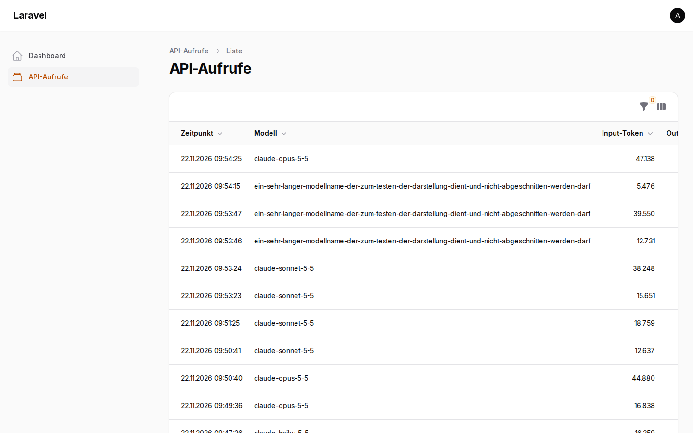
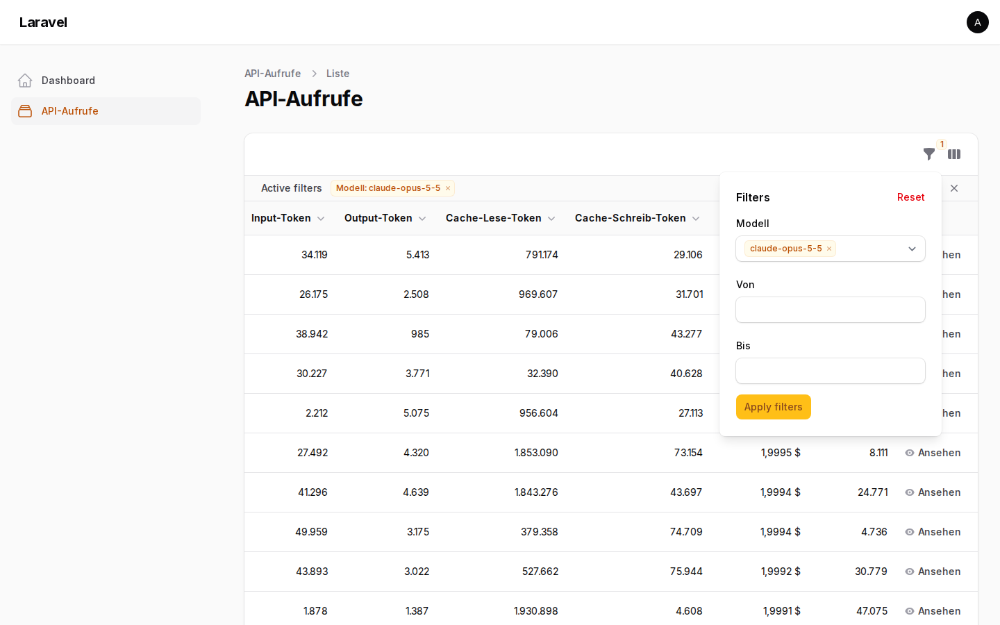
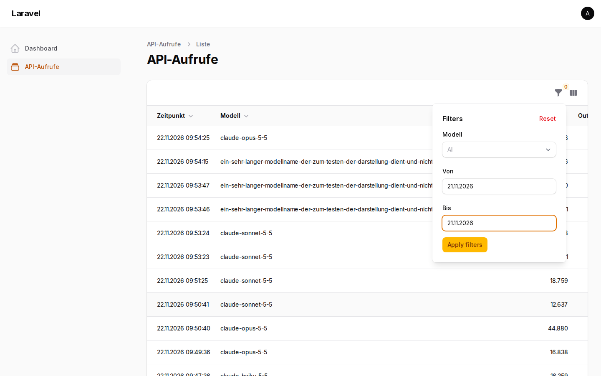
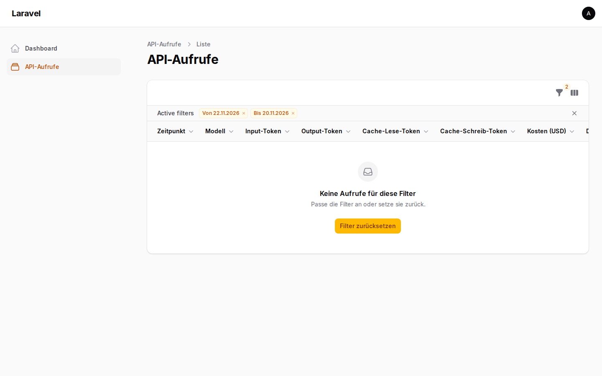
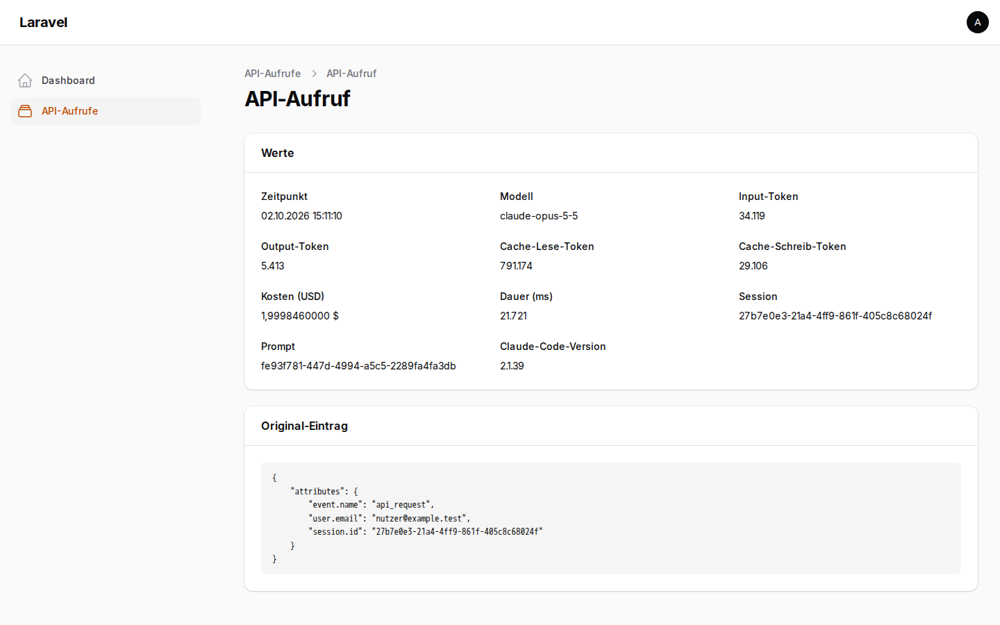
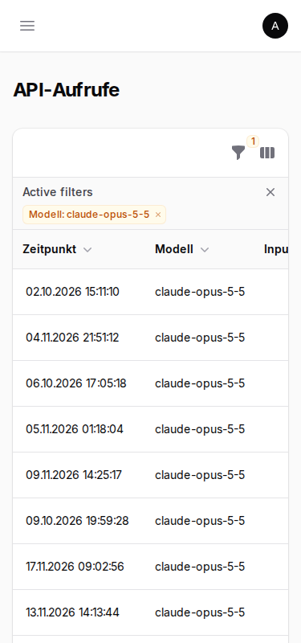
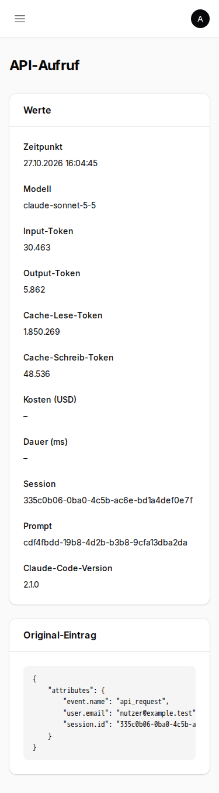

# QA-Bericht: PROJ-2 Liste der API-Aufrufe im Admin-Panel (#10)

**Spec:** [spec.md](spec.md) · **Design:** [design.md](design.md)
**Getestet am:** 2026-11-22 · **Commit:** `54c8b55`

## Ergebnis
**Produktionsreif:** Ja
- Akzeptanzkriterien: 28 von 28 bestanden
- Edge Cases: 8 von 8 bestanden
- Bugs: Critical 0 · High 0 · Medium 0 · Low 1 (behoben)

Getestet mit Pest/Livewire (automatisiert) und im Browser (Chromium, Playwright) gegen die lokale App mit 100.000 erzeugten Aufrufen, auf 1440px und 375px.

## Akzeptanzkriterien
- ✅ AK-1: Menü „API-Aufrufe“, Titel „API-Aufrufe“, alle Aufrufe mit den 8 festen Spalten (Test + Browser)
- ✅ AK-2: Standard-Sortierung neueste oben (Test + Browser)
- ✅ AK-3: Session, Prompt, Version anfangs ausgeblendet (Test)
- ✅ AK-4: nach Einblenden mit Werten sichtbar (Test)
- ✅ AK-5: alle 8 sortierbaren Spalten auf- und absteigend; zweiter Klick kehrt um (Test + Browser)
- ✅ AK-6: Session, Prompt, Version nicht sortierbar, kein Klick-Kopf (Test)
- ✅ AK-7: Modell-Filter bietet genau die gespeicherten Modelle, ohne Doppelte (Test)
- ✅ AK-8: Mehrfachauswahl (Test + Browser)
- ✅ AK-9: ohne Auswahl alle Modelle (Test)
- ✅ AK-10: ein Tag inkl. 00:00:00 und 23:59:59.999 deutscher Zeit (Test + Browser: nur 21.11.2026)
- ✅ AK-11: nur „von“ (Test)
- ✅ AK-12: nur „bis“ (Test)
- ✅ AK-13: 21.11. 23:30 UTC erscheint bei Filter 22.11. (Test)
- ✅ AK-14: Modell UND Zeitraum (Test)
- ✅ AK-15: `01.07.2026 14:00:00` und `15.01.2026 13:00:00` (Test)
- ✅ AK-16: `12.345`, `1.234.567`, `4.321`, `0,0123 $` (Test + Browser)
- ✅ AK-17: genau fünf `–` in der Zeile, keine `0` (Test)
- ✅ AK-18: Detailansicht „API-Aufruf“ mit allen Werten, Kosten mit allen 10 gespeicherten Stellen, eingerücktes JSON (Test + Browser)
- ✅ AK-19: `nutzer@example.test` im Original-Eintrag sichtbar (Test + Browser)
- ✅ AK-20: keine Anlegen-/Ändern-/Löschen-Schaltflächen oder Massenaktionen (Test + Browser)
- ✅ AK-21: `/admin/api-aufrufe/create` und `/admin/api-aufrufe/{id}/edit` → 404, Daten unverändert (Test)
- ✅ AK-22: 50 pro Seite, umschaltbar 25/100 (Test + Browser)
- ✅ AK-23: 100.000 Aufrufe im Browser: Seite laden ca. 0,9 s, Umsortieren 0,2–1,0 s, Modell-Filter 0,2 s, Zeitraum-Filter 0,2 s, 100 pro Seite 0,2 s
- ✅ AK-24: leere Datenbank: „Noch keine API-Aufrufe“ + `php artisan tokens:import` (Test)
- ✅ AK-25: „Keine Aufrufe für diese Filter“ + „Filter zurücksetzen“ funktioniert (Test + Browser)
- ✅ AK-26: Filter nach Rückkehr aus der Detailansicht erhalten, per „Zurück“ und per Menü (Test + Browser)
- ✅ AK-27: ohne Anmeldung Weiterleitung zu `/admin/login` für Liste und Detail (Test)
- ✅ AK-28: in `production` 403 (Test)

## Edge Cases
- ✅ EC-1: „bis“ vor „von“ → leere Liste mit Hinweis aus AK-25, kein Absturz (Test + Browser)
- ✅ EC-2: 60 Aufrufe mit gleichem Zeitpunkt, beim Blättern jeder genau einmal (Test)
- ✅ EC-3: fehlende Kosten/Dauer in beiden Richtungen am Ende (Test)
- ✅ EC-4: 25.10.2026 (25 Stunden) komplett erfasst (Test)
- ✅ EC-5: neue Aufrufe erscheinen nach Neuladen; Liste fragt bei jedem Laden neu ab (keine Zwischenspeicherung)
- ✅ EC-6: langer Modellname vollständig in einer Zeile (Tabelle scrollt waagerecht); Original-Eintrag vollständig und scrollbar, auch auf 375px (Browser)
- ✅ EC-7: unbekannte ID → 404 (Test)
- ✅ EC-8: Kosten 0 → `0,0000 $` (Test)

## Bugs
- **B-1 (Low, behoben):** Im Zeitraum-Filter blieb der Kalender nach der Tagesauswahl offen und verdeckte das Feld „Bis“. Behoben: Kalender schließt nach der Auswahl.

## Sicherheit
- Nur lesend: es gibt keine Routen zum Anlegen, Ändern, Löschen; die Ressource verbietet es zusätzlich. Test bestätigt, dass Ansehen, Filtern und Sortieren nichts in der Datenbank ändern.
- HTML in gespeicherten Werten (Modell, Original-Eintrag) wird maskiert ausgegeben (Test).
- Ungültige Datumswerte im Filter werden ignoriert, kein Absturz (Test).
- Zugang nur angemeldet und nicht in `production` (bestehende Panel-Regel, Tests).
- Keine Geheimnisse im Code, kein Netzwerkzugriff nach außen.

## Automatisierte Tests
- `tests/Feature/ApiRequests/ApiRequestResourceTest.php`: 42 Tests (Livewire/HTTP) für alle AK und EC sowie Sicherheit.
- Gesamt: Pint ✅, PHPStan Level 8 ✅, Pest 87/87 ✅. Kein E2E-Framework im Stack; Browser-Prüfung manuell per Playwright-Skript außerhalb des Repos.

## Hinweise
- Beschriftungen, die Filament selbst mitbringt („Filters“, „Apply filters“, „Reset“, „Active filters“, Wochentage im Kalender), sind englisch, weil die App-Sprache `en` ist. Die Spec verlangt keine Umstellung.

## Screenshots

