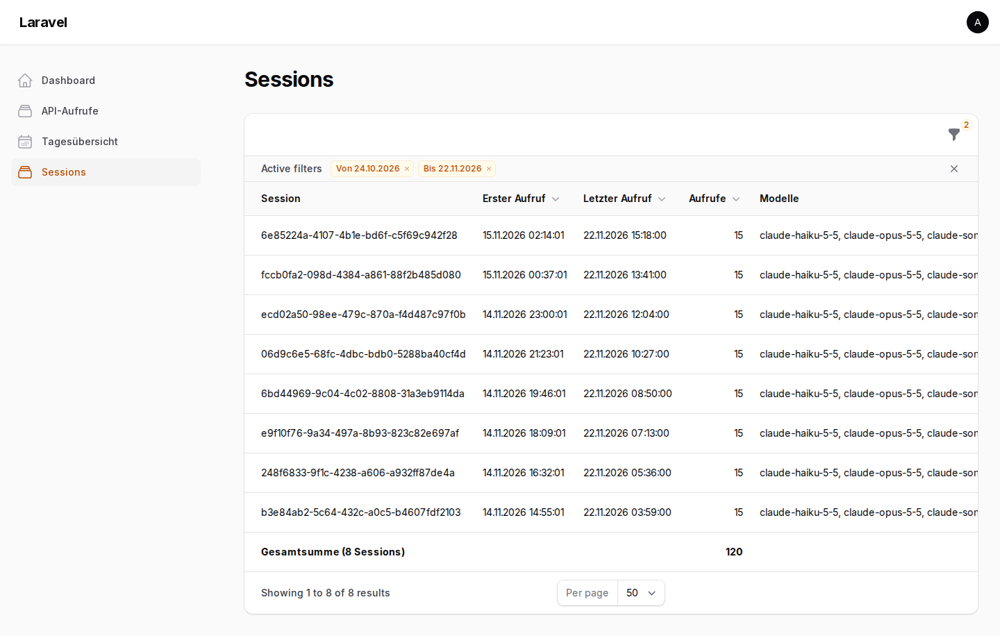
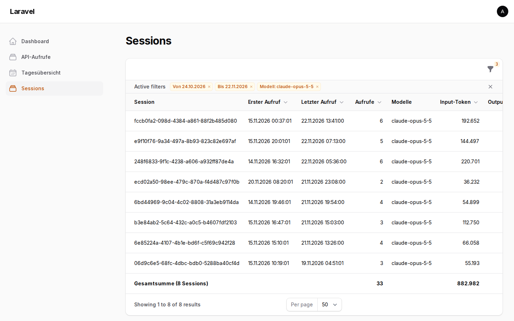
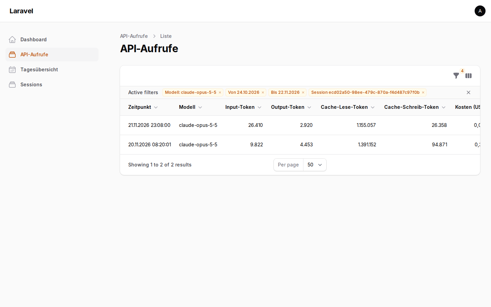
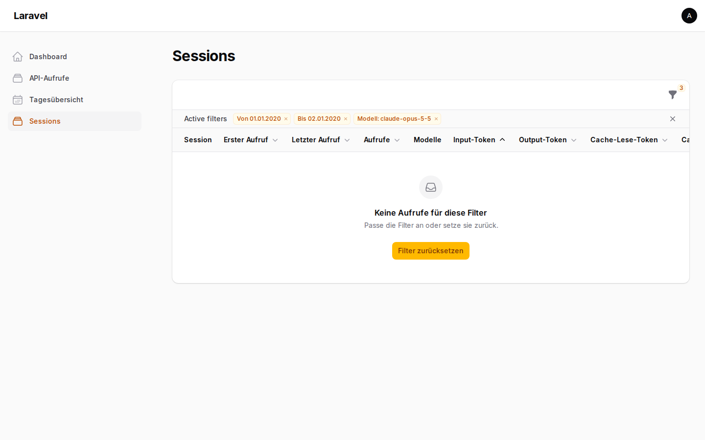
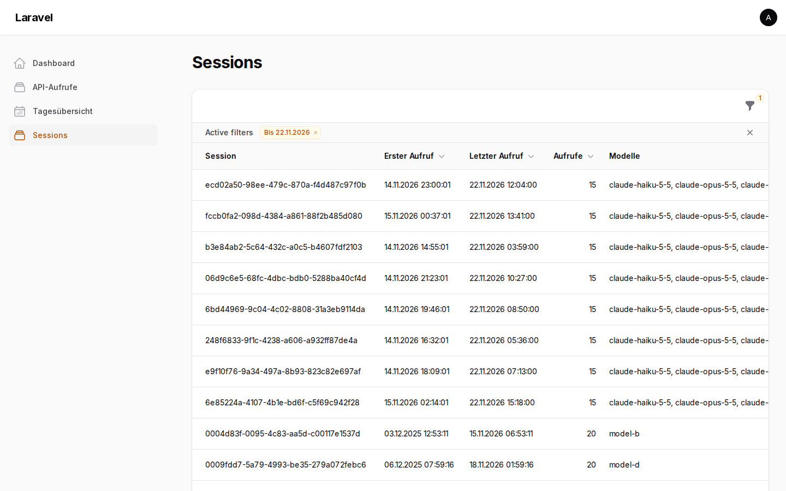
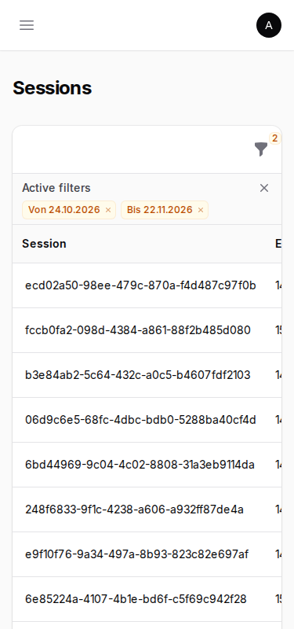

# QA-Bericht: PROJ-4 Auswertung nach Session (#17)

**Spec:** [spec.md](spec.md) · **Design:** [design.md](design.md)
**Getestet am:** 2026-11-22 · **Commit:** `104da3b`

## Ergebnis
**Produktionsreif:** Ja
- Akzeptanzkriterien: 39 von 39 bestanden
- Bugs: Critical 0 · High 0 · Medium 0 · Low 0 (ein Hinweis, siehe unten)

## Akzeptanzkriterien
- ✅ AK-1: Menüpunkt „Sessions“, Titel „Sessions“, genau die 10 Spalten (Test + Browser)
- ✅ AK-2: eine Zeile je Session, Summen aller vier Token-Spalten, Aufrufe und Kosten (Test)
- ✅ AK-3: erster/letzter Aufruf in deutscher Zeit (`21.11.2026 10:00:00` / `12:30:00`) (Test)
- ✅ AK-4: Modelle einmal, alphabetisch, `model-a, model-b` (Test + Browser)
- ✅ AK-5: Session-ID mit 36 Zeichen vollständig sichtbar (Test + Browser)
- ✅ AK-6: `12.345`, `1.234.567`, `0,0123 $` (Test)
- ✅ AK-7 bis AK-9: `0,0300 $ (1 ohne Kosten)`, `–`, `0,0000 $` (Test + Browser)
- ✅ AK-10: Standard letzter Aufruf, neueste zuerst (Test + Browser)
- ✅ AK-11: alle 8 sortierbaren Spalten in beide Richtungen (Test, je Spalte; Browser: Kosten, Input-Token)
- ✅ AK-12, AK-13: Sessions mit `–` in beiden Richtungen am Ende; sortiert nach Summe der bekannten Kosten (Test)
- ✅ AK-14: Session und Modelle nicht sortierbar, kein Sortier-Pfeil (Test + Browser)
- ✅ AK-15: Standard 24.10.2026 bis 22.11.2026, ältere Aufrufe fehlen in Zeilen und Summe (Test + Browser)
- ✅ AK-16 bis AK-19: Zeitraum mit beiden, nur „von“, nur „bis“; 00:00:00 und 23:59:59 zählen; Session ohne passende Aufrufe fehlt (Test)
- ✅ AK-20: 21.11. 23:30 UTC zählt am 22.11. (Test)
- ✅ AK-21 bis AK-23: Modell-Auswahl genau aus gespeicherten Modellen, Zeile, Spalte Modelle und Gesamtsumme nur mit gewählten Modellen (Test + Browser)
- ✅ AK-24: Gesamtsumme identisch mit der Tagesübersicht bei gleichen Filtern (Aufrufe, vier Token-Werte, Kosten) (Test)
- ✅ AK-25, AK-26: Gesamtsumme mit Anzahl der Sessions, `(n ohne Kosten)` bzw. `–` (Test + Browser)
- ✅ AK-27, AK-28: 50 pro Seite, umschaltbar 25/100, Gesamtsumme auf jeder Seite für alle Sessions (Test + Browser)
- ✅ AK-29: Klick öffnet „API-Aufrufe“ mit Session-, Zeitraum- und Modell-Filter; Liste zeigt genau die gezählten Aufrufe (Test + Browser: Zeile 2 Aufrufe → Liste 2 Aufrufe)
- ✅ AK-30: leere Filter werden leer übergeben, auch wenn die Liste vorher andere Filter gemerkt hatte (Test)
- ✅ AK-31: Session-Filter als „Session <ID>“ sichtbar und einzeln entfernbar (Test + Browser)
- ✅ AK-32: Filter, Sortierung und Seitengröße bleiben nach Rückkehr erhalten (Test + Browser)
- ✅ AK-33: leere Datenbank → „Noch keine API-Aufrufe“ und `php artisan tokens:import` (Test)
- ✅ AK-34: keine Treffer → Hinweis, „Filter zurücksetzen“ stellt Standard-Zeitraum her (Test + Browser)
- ✅ AK-35: keine Aktionen zum Anlegen, Ändern, Löschen (Test)
- ✅ AK-36: Browser, 100.120 Aufrufe in 5.008 Sessions über 365 Tage: Laden 1,0 s, Filter 0,5 s, Seitengröße 100 0,6 s, Sortieren 0,6 s, Blättern 0,6 s, Neuladen 1,4 s; im Test ebenfalls unter 2 s
- ✅ AK-37: Liste mit Session-Filter per Sprung im Browser 0,9 s (Test ebenfalls unter 2 s; Index auf Session-ID)
- ✅ AK-38: nicht angemeldet → Weiterleitung zu `/admin/login` (Test + curl: 302)
- ✅ AK-39: `production` → 403 (Test)

## Edge Cases
- ✅ EC-1: „bis“ vor „von“ → keine Sessions, Hinweis aus AK-34
- ✅ EC-2: Session über Tagesgrenzen erscheint einmal, nur passende Aufrufe zählen
- ✅ EC-3: Tag der Zeitumstellung 25.10.2026 vollständig, Uhrzeiten korrekt
- ✅ EC-4: bei gleichen Kosten erscheint beim Blättern jede Session genau einmal (Session-ID als zweites Sortierkriterium)
- ✅ EC-5: eine Session mit einem Aufruf → erster = letzter Aufruf
- ✅ EC-6: sehr lange Session-ID und 12 Modelle vollständig (Tabelle scrollt waagerecht)
- ✅ EC-7, EC-8: 10 Mrd. Token korrekt, 10.000 × 0,00001234 $ = `0,1234 $`
- ✅ EC-9: keine Zwischenspeicherung, jede Interaktion rechnet neu
- ✅ EC-10: unbekannte Session-ID in der Adresse → leere Liste mit „Keine Aufrufe für diese Filter“

## Bugs
- Keine.
- **Hinweis (kein Bug):** Die Zahl in `(n ohne Kosten)` erscheint ohne Tausenderpunkt (z. B. `(9100 ohne Kosten)`). Das Format stammt unverändert aus PROJ-3 (gemeinsame Formatierung) und wurde bewusst nicht geändert, damit beide Seiten gleich aussehen.

## Sicherheit
- Nur lesender Zugriff, Test „ändert beim Anzeigen keine Daten“ grün.
- Session-IDs mit HTML werden maskiert ausgegeben; der Link wird sicher kodiert (Test).
- Manipulierte Filter, unbekannte Sortierspalten (SQL-Fragment) und Seitengröße 1000 → kein Absturz; Sortierung nur über eine feste Liste erlaubter Spalten, Seitengröße auf 25/50/100 beschränkt (Test).
- Zugang unverändert über die Panel-Regel (Anmeldung, nicht in `production`).
- Keine Konsolenfehler im Browser (1440 px und 375 px).

## Automatisierte Tests
- Pest: `tests/Feature/SessionUsage/SessionUsagePageTest.php` mit 49 Tests (alle AK/EC, Sicherheit, Leistung); gesamte Suite 175 Tests grün. Pint und PHPStan (Level 8) grün.
- E2E: kein E2E-Framework im Stack; Browser-Abläufe manuell mit Playwright geprüft.

## Screenshots

